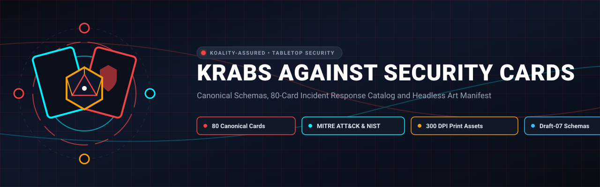
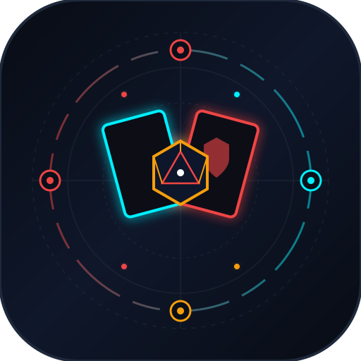

<div align="center">



# Krabs Against Security Cards

<p align="center">
  
</p>

**Canonical Schemas, 80-Card Incident Response Catalog and Headless Art Manifest**

[](https://github.com/Koality-Assured/krabs-against-security-cards/actions/workflows/ci.yml)
[](LICENSE)
[](pyproject.toml)
[]()
[](https://conventionalcommits.org)

</div>

---

**Krabs Against Security (K.A.S.)** is an open-source, web-native and print-and-play cybersecurity incident response card game. It adapts the proven tabletop mechanics of Black Hills Information Security's (BHIS) [*Backdoors & Breaches*](https://www.blackhillsinfosec.com/projects/backdoors-and-breaches/) into an undersea corporate parody setting featuring the Krusty Krab SOC defending the Secret Formula against the Plankton Advanced Persistent Threat (APT-Chum).
This repository serves as the canonical headless data package, schema authority, and visual generation manifest for the K.A.S. ecosystem.
---
## 1. Incident Response Framework Alignment
The core educational value of K.A.S. is grounded in industry-standard incident handling and threat intelligence frameworks:
```
+-----------------------------------------------------------------------------------+
|                            NIST SP 800-61r2 Phases                                |
|  [Preparation] -> [Detection & Analysis] -> [Containment & Eradication] -> [AAR]  |
+-----------------------------------------------------------------------------------+
         ^                     ^                             ^                  ^
         |                     |                             |                  |
+-----------------+   +------------------+          +------------------+   +--------+
| Injects & Setup |   | Attack Decks:    |          | Procedures:      |   | Post-  |
| (Complications) |   | IC, PE, P, C2    |          | d20 Checks, EDR, |   | Mortem |
|                 |   | (MITRE ATT&CK)   |          | Kerberos Purge   |   | Review |
+-----------------+   +------------------+          +------------------+   +--------+
```
### 1.1 NIST SP 800-61r2 Lifecycle
- **Preparation**: Baseline network hardening, monitoring setup, and inject friction cards.
- **Detection & Analysis**: Defensive procedures (Log Analysis, Network Inspection, Memory Dumps) to triage active threats.
- **Containment, Eradication & Recovery**: Host isolation, golden ticket revocation, firewall egress filtering, and golden image redeployments.
- **Post-Incident Activity**: After-Action Root Cause Post-Mortem and executive mitigation.
### 1.2 MITRE ATT&CK® Enterprise Matrix
All 48 attack cards map directly to authentic MITRE ATT&CK techniques (e.g., `T1566.001 Spearphishing Attachment`, `T1550.002 Pass the Hash`, `T1558.001 Golden Ticket`, `T1071.004 DNS Tunneling`).
---
## 2. Card Deck Breakdown (80 Canonical Cards)
The Core Set v1 contains exactly **80 canonical cards**:
| Deck | Color Identity | Count | Mechanical Purpose | Key Characteristics |
| :--- | :--- | :---: | :--- | :--- |
| **Initial Compromise** | Crimson / Red | 12 | Attack Vector Slot 1 | Phishing, public-facing server exploits, USB duckies, supply chain taps |
| **Pivot & Escalate** | Amber / Yellow | 12 | Attack Vector Slot 2 | Lateral movement, LOLBins, Pass-the-Hash, Kerberoasting, privilege escalation |
| **Persistence** | Violet / Purple | 12 | Attack Vector Slot 3 | Run keys, PHP web shells, cron jobs, UEFI bootkits, Golden Clam tickets |
| **C2 & Exfiltration** | Bronze / Brown | 12 | Attack Vector Slot 4 | DNS tunneling, S3 bucket egress, Red Snapper POS ransomware, ICMP sonar |
| **Procedures** | Ocean Blue | 16 | Defender d20 Actions | Memory forensics, Zeek PCAP, SIEM logs, Host isolation (checks 10+ to 14+) |
| **Injects** | Kelp Green / Slate | 16 | Operational Chaos | Strike penalties, difficulty modifiers (+2/+3), turn losses, cable snaps |
### 2.1 The Core Game Loop
1. **Scenario Setup**: The Incident Master places one card face-down from each of the 4 attack decks (`IC`, `PE`, `P`, `C2`).
2. **Defensive Investigation**: Defenders choose a **Procedure Card** (Endpoint, Network, Log Analysis, Technical Controls, Threat Intel, Legal) and roll a $d20$.
3. **Roll Resolution**:
   - $\ge \text{d20 Threshold}$: Card or telemetry revealed / phase neutralized.
   - $< \text{d20 Threshold}$: Failure triggers a **Strike** on the 10-strike doom clock.
4. **Inject Complications**: On predetermined strike intervals or critical failures, an **Inject Card** is drawn, introducing operational friction (executive budget vetoes, shift end, cable shears).
5. **Resolution**: Defenders win by neutralizing all 4 attack vectors before reaching 10 strikes.
---
## 3. Repository Architecture
```
krabs-against-security-cards/
├── schemas/                               # Versioned JSON Schemas
│   ├── card-schema-v1.json               # Schema for all 6 card types
│   ├── deck-schema-v1.json               # Schema for deck collections & scenarios
│   └── art-manifest-v1.schema.json       # Schema for generative art manifests
├── cards/
│   └── core-v1/
│       └── cards.json                    # 80 canonical cards + 3 curated scenarios
├── art/
│   └── art_manifest.json                 # 80 FLUX/SDXL prompts, seeds & asset paths
├── tests/
│   └── test_cards.py                     # Schema validation & integrity test suite
├── package.json                          # npm package metadata and validation scripts
├── LICENSE                               # CC BY-SA 4.0 Legal Text & BHIS Attribution
└── README.md                             # Documentation & specifications
```
---
## 4. Schemas Specification
### 4.1 Card Schema (`schemas/card-schema-v1.json`)
Validates individual cards across all six types. Enforces required fields:
- `id`: Pattern `^(IC|PE|P|C2|PR|INJ)-[0-9]{3}$`
- `slug`: Kebab-case URL-safe string
- `title`: Display title
- `deck`: Enum of the 6 decks
- `type`: Functional card type
- `description`: Technical IR and gameplay narrative
- `flavor_text`: Satirical quote or lore
- `nist_phase`: NIST SP 800-61r2 phase
- `art_id`: Art manifest cross-reference
- **Conditional Requirements**:
  - `procedures`: Requires `d20_threshold` (integer between 10 and 18) and `procedure_category`.
  - Attack decks (`initial_compromise`, `pivot_escalate`, `persistence`, `c2_exfil`): Requires `attack_technique_id` (`T1xxx` or `T1xxx.xxx`) and `attack_technique_name`.
### 4.2 Deck Schema (`schemas/deck-schema-v1.json`)
Validates deck bundles, metadata, versioning, card counts, and curated tabletop scenarios.
### 4.3 Art Manifest Schema (`schemas/art-manifest-v1.schema.json`)
Defines the Tier 1 metadata contract for the 3-Tier Art Deferral Pipeline.
---
## 5. Three-Tier Art Deferral Pipeline
Visual asset creation is decoupled from rules and application releases:
1. **Tier 0 (Procedural Vector Fallback)**:
   Pure CSS/SVG templates utilizing system fonts, nautical vector iconography, and semantic color borders. The game is **100% playable and printable on Day 1** without requiring external raster images.
2. **Tier 1 (Typed Art Manifest - `art/art_manifest.json`)**:
   Machine-readable catalog of all 80 cards with curated FLUX.1-dev / SDXL prompts, negative prompts, aspect ratios (`4:3`), deterministic seeds, and status markers (`art_status: "deferred"`).
3. **Tier 2 (Asynchronous Batch Synthesis)**:
   Automated generation pipelines synthesize WebP web assets ($800 \times 600\text{ px}$) and 300 DPI print-ready PNGs that hydrate cleanly into the web client and print studio.
---
## 6. Testing & Validation
The test suite verifies:
- 100% of cards validate against Draft-07 schemas.
- Exact distribution of 80 cards (12 IC, 12 PE, 12 P, 12 C2, 16 PR, 16 INJ).
- Absolute uniqueness of all card IDs, slugs, and art IDs.
- d20 thresholds strictly bounded between 10 and 18 for all procedures.
- MITRE ATT&CK technique IDs conform to `^T1[0-9]{3}(\.[0-9]{3})?$`.
- 1-to-1 parity between `cards.json` and `art_manifest.json`.
- Tabletop scenario references point to valid attack and inject cards.
Run validation:
```bash
# Using pytest
pytest -v
# Using Python directly
python tests/test_cards.py
# Using npm script
npm run validate
```
---
## 7. Licensing, Attribution & Fair Use
### 7.1 Creative Commons (CC BY-SA 4.0)
*Krabs Against Security* is an educational parody based on **Backdoors & Breaches** by **Black Hills Information Security (BHIS)**, licensed under [Creative Commons Attribution-ShareAlike 4.0 International (CC BY-SA 4.0)](https://creativecommons.org/licenses/by-sa/4.0/).
- **Attribution**: Based on Backdoors & Breaches by Black Hills Information Security (BHIS), licensed under CC BY-SA 4.0. Original project: [https://www.blackhillsinfosec.com/projects/backdoors-and-breaches/](https://www.blackhillsinfosec.com/projects/backdoors-and-breaches/).
- **ShareAlike**: All card content, schemas, mechanics, and modifications in this repository are licensed under CC BY-SA 4.0.
### 7.2 Parody & Trademark Disclaimer
*Krabs Against Security* is an independent educational parody created under United States Fair Use doctrine (*Campbell v. Acuff-Rose Music*, *Jack Daniel's Properties v. VIP Products*). It is not affiliated with, sponsored by, or endorsed by Nickelodeon, Paramount Global, or ViacomCBS. All illustrations, text, and naming are original satirical creations.
